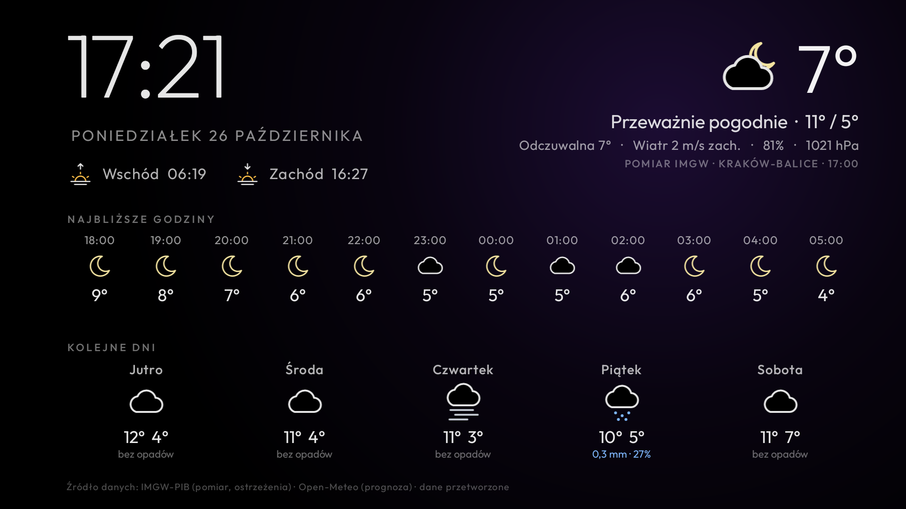

# Pogoda – ekran pogody dla Android TV

Pełnoekranowa pogoda dla jednego miejsca w Polsce:
- zegar i data, wschód i zachód słońca,
- pogoda teraz,
- 12 najbliższych godzin i 5 kolejnych dni,
- ostrzeżenia IMGW dla powiatu.

Pakiet `tv.pogoda.imgw`, ok. 90 KB, czysta Java, bez bibliotek, bez usług w tle. Na bazie
[weatherclock-tv](https://github.com/matyivagyok/weatherclock-tv) (MIT), z fontem Outfit (SIL OFL). Dobrze
współpracuje z launcherem [cleanyourtv](https://github.com/Gathin23/cleanyourtv).



## Skąd są dane

| Co | Źródło |
|---|---|
| Temperatura, wiatr, wilgotność, ciśnienie teraz | **IMGW-PIB**: godzinowy pomiar ze stacji synoptycznej (`danepubliczne.imgw.pl/api/data/synop/id/<stacja>`). Jeśli pomiar jest starszy niż 3 godziny, ekran pokazuje wartość z modelu z dopiskiem „Model Open-Meteo”. |
| Ostrzeżenia meteorologiczne | **IMGW-PIB** (`/api/data/warningsmeteo`), tylko dla jednego powiatu (TERYT) i tylko obowiązujące |
| Niebo teraz, odczuwalna, 12 godzin, 5 dni, wschód i zachód słońca | **Open-Meteo** dla podanych współrzędnych. Dla Polski to głównie modele ICON-D2 (2 km) i ECMWF |

IMGW nie udostępnia publicznie prognoz. Prognozy z meteo.imgw.pl idą przez nieudokumentowany serwer z tokenem
aplikacji mobilnej, więc nie są tu używane. Regulamin IMGW-PIB wymaga podania źródła i informacji o przetworzeniu
danych: jest to napisane na dole ekranu. Dane IMGW-PIB i Open-Meteo są darmowe do użytku niekomercyjnego.

Ostrzeżenia IMGW są przetestowane na danych w formacie IMGW (`WeatherTest`), jeszcze nie na prawdziwym ostrzeżeniu.

## Twoje miejsce

Domyślnie aplikacja pokazuje pogodę dla centrum Krakowa. Swoje miejsce ustawiasz tak:
1. Skopiuj `place.properties.example` do `place.properties` (ten plik nie trafia do gita).
2. Wpisz w nim swoje wartości:
   - `latitude` / `longitude`: współrzędne dla prognozy,
   - `synop_id` / `station_name`: najbliższa stacja synoptyczna IMGW (lista: https://danepubliczne.imgw.pl/api/data/synop),
   - `teryt`: czterocyfrowy kod powiatu dla ostrzeżeń,
   - `place_name`: nazwa pokazywana przy danych z modelu.

## Budowanie i instalacja

Potrzebne są JDK 17 i Android SDK 34 z build-tools 34.0.0 (najprościej Android Studio). Telewizor musi mieć
włączone debugowanie USB i być dostępny po sieci. Skrypt używa klienta ADB z
[cleanyourtv](https://github.com/Gathin23/cleanyourtv), który działa bez binarki `adb`.

```bash
git clone https://github.com/Gathin23/cleanyourtv ../cleanyourtv
(cd ../cleanyourtv && python3 -m venv tools/venv && tools/venv/bin/pip install -r tools/requirements.txt)
TV_HOST=<ip telewizora> ./build-and-install.sh --show
```

Bez cleanyourtv: `./gradlew assembleRelease`, a potem `adb install -r app/build/outputs/apk/release/app-release.apk`.

## Gdzie się pokazuje

- **Kafelek „Pogoda”** w siatce aplikacji otwiera ekran pogody. Każdy przycisk poza głośnością go zamyka.
- **Jako wygaszacz systemowy**:
  `adb shell settings put secure screensaver_components tv.pogoda.imgw/.WeatherDream`.
  Niektóre telewizory (np. Philips z Android TV 11) przy każdym starcie ustawiają czas wygaszacza na „Nigdy”;
  tam lepiej działa rozwiązanie z launchera opisane niżej.
- **Z launcherem cleanyourtv** (wymaga łatki z `cleanyourtv-launcher/`):
  - po kilku minutach bezczynności na ekranie głównym zamiast zegara pokazuje się ekran pogody,
  - pod datą jest jedna linijka pogody z tą samą ikoną, np. „7° · Przeważnie pogodnie · jutro 12° / 4°”.

### Łatka launchera cleanyourtv

`cleanyourtv-launcher/launcher-weather.patch` dodaje do launchera dwie opcje. Obie są domyślnie wyłączone, a launcher
nadal nie ma dostępu do internetu. Pobiera tylko ta aplikacja, a launcher czyta jedną linijkę z jej
`ContentProvider` (`content://tv.pogoda.imgw.now/line`, kolumny `line` i `icon`).

```bash
cd ../cleanyourtv
git apply ../pogoda-tv/cleanyourtv-launcher/launcher-weather.patch
```

Potem w `launcher/app/src/main/res/values/config.xml` dopisz:

```xml
<integer name="home_idle_clock_minutes">3</integer>   <!-- ta linia już istnieje: ustaw minuty -->
<string name="idle_activity" translatable="false">tv.pogoda.imgw/.WeatherActivity</string>
<string name="home_weather_authority" translatable="false">tv.pogoda.imgw.now</string>
```

i przebuduj launcher (`launcher/build-and-install.sh`). Łatka powstała na commicie `f592b6d2` cleanyourtv.
Po zmianach w launcherze może wymagać dopasowania. Gdy aplikacja Pogoda jest wyłączona lub usunięta, launcher
wraca do zegara, a linijka znika.

## Lekkość

Zmierzone na Philips 55OLED887 (Android TV 11, 2,7 GB RAM):

| Stan | Pamięć (PSS) | CPU |
|---|---|---|
| Launcher cleanyourtv przed / po łatce | 75,0 MB / 74,5 MB | – |
| Pogoda, gdy tylko odpowiada launcherowi | 4,5 MB | – |
| Pogoda z widocznym ekranem | 32–42 MB | 0% w spoczynku, krótki skok przy przygaszeniu co 30 s |

Nic nie działa w tle: brak usług, alarmów i odpytywania. Dane są pobierane:
- przy otwarciu ekranu, jeśli są starsze niż 20 minut, a potem co 30 minut, dopóki ekran jest widoczny,
- gdy launcher pyta o linijkę, a dane są starsze niż 30 minut.

Każde pobranie to 3 małe zapytania (razem kilka KB). Ostatnie dane są zapisane, więc ekran pokazuje się od razu,
także bez internetu. Dane starsze niż 6 godzin są ukrywane. Po aktualizacji, która zmienia zapytanie (np. nowe
pola), zapisane dane są pobierane od nowa.

## Wygląd

- **Ikony:** własny zestaw 14 rysunków wektorowych cienką kreską (`app/src/main/res/drawable/ic_w_*.xml`),
  jednakowy na każdym telewizorze. Emoji systemowe nie pasowały do siebie stylem. `res/raw/keep.xml` chroni ikony
  przed usunięciem przy kompilacji, bo launcher wczytuje je po nazwie.
- **Ochrona OLED:** co 30 sekund cała treść przygasa (0,7 s), przeskakuje w nowe, losowe miejsce do ±24 dp
  w poziomie i ±16 dp w pionie od środka i rozjaśnia się (0,9 s). Co minutę poświata zmienia kolor.

## Testy

```bash
./gradlew testReleaseUnitTest
```

Testy sprawdzają parser na zapisanych odpowiedziach IMGW i Open-Meteo: pomiar kontra model, godziny, dni, wschód
i zachód słońca, ostrzeżenia dla powiatu, ikony dla kodów pogody.

## Licencja

MIT (`LICENSE`), z zachowaniem praw autorów weatherclock-tv i cleanyourtv. Font Outfit: SIL Open Font License
(`FONT-LICENSE-OFL.txt`).
